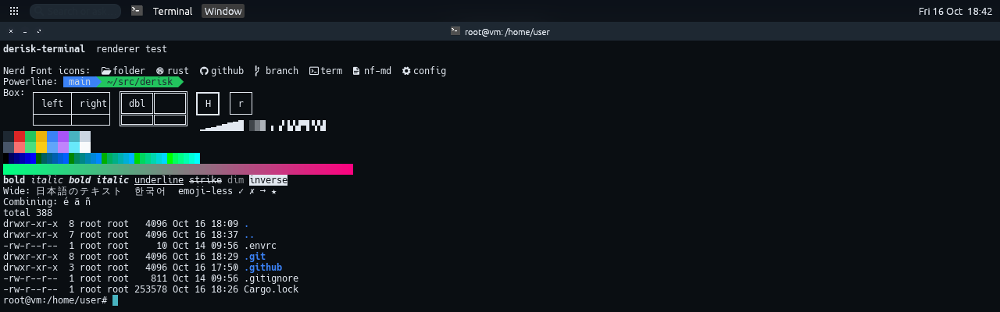

# The terminal

The desktop's terminal is derisk's own, `derisk-terminal`
(`crates/derisk-terminal` in derisk), and the image ships no other: it
replaced foot, which the image carried only because derisk had none. The
virtual machine template's guest ships it too ([hypervisor.md](hypervisor.md)).
Super+Enter opens one, as it does in i3 and sway; "Move to main pane",
which had that key before, is Super+Shift+Enter. Settings files saved
before the change are moved over to it when they still hold the old keys.

- **Nerd Font icons.** It draws the theme's monospace font through that
  font's Nerd Font build when one is installed, and takes what a font lacks
  from Symbols Nerd Font, then from the usual monospace fonts. The image
  installs Hack Nerd Font, Hack being the theme's default, and the
  symbols-only Nerd Font, which gives the icons to a theme naming a font
  with no Nerd Font build (`nixos/modules/desktop.nix`). An icon followed by
  a blank cell may take both, as Nerd Font icons are drawn to. Box drawing
  and block characters are drawn to the cell, not taken from the font, so
  lines meet across cells in any font.
- **On the GPU, or in software.** It draws each frame on the GPU through
  OpenGL ES 3 (or OpenGL 3.3) in one draw call, from an atlas of the glyphs
  it has drawn before. Where there is no GPU, or OpenGL is itself drawn in
  software (llvmpipe), it draws the same frame on the CPU into shared memory
  instead, which is faster than llvmpipe. `--renderer gpu` or
  `--renderer software` picks one by hand.
- **Deferred.** What the shell prints only changes the grid; a frame is
  built from the grid when the compositor asks for one, so a command that
  prints a lot draws once per frame, not once per line.
- **The desktop's theme.** Colours and the font follow derisk's theme, and a
  change in Settings reaches a running terminal the next time it is focused.

It takes foot's command line (a bare command or `-e`, `-a`/`--app-id`,
`-T`/`--title`, `-D`), so a desktop entry written for foot runs in it with
only the program's name changed.

`checks.x86_64-linux.terminal` (`nixos/tests/terminal.nix`) starts it under
cage in a VM with no GPU, where it has to choose software, and again with
`--renderer gpu`, where it has to draw through llvmpipe, and reads its text
off the screen both times. The image's own boot test checks it, Hack Nerd
Font and the symbols font are installed and foot is not.
